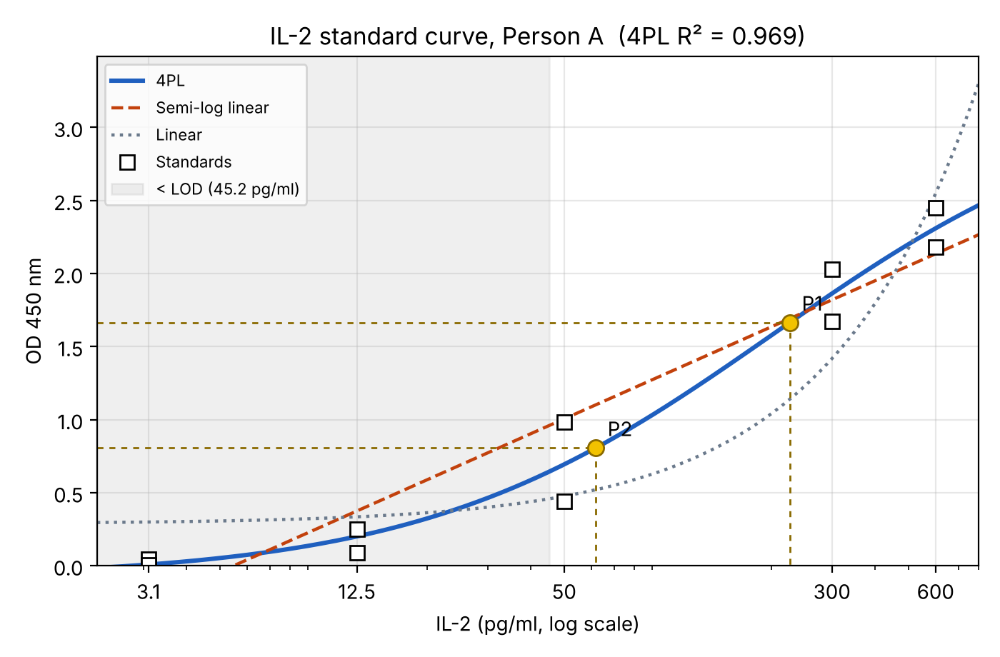
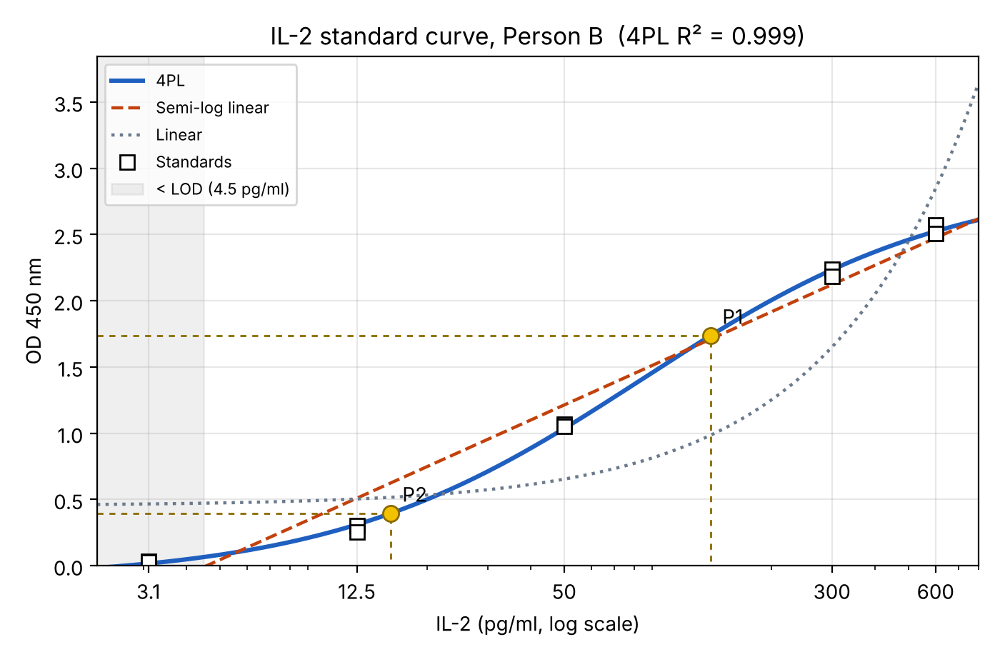

# IL-2 sandwich ELISA: standard curve and back-calculation

Data from the immunology block course at the Institute of Molecular and Clinical Immunology, OVGU Magdeburg (August 2025). We measured IL-2 in two cell culture supernatants (P1 stimulated, P2 unstimulated) with a sandwich ELISA. Standards were 0, 3.1, 12.5, 50, 300 and 600 pg/ml, every well in duplicate, read at 450 nm. Samples were diluted 1:100 before the assay.

In the course, concentrations were calculated with the plate reader software (spline interpolation). This script recalculates them with three standard curve models so the choice of model can be compared.

## What the script does

1. Fits three calibration models on the individual replicates: linear, semi-log linear and four-parameter logistic (4PL).
2. Back-calculates the IL-2 concentration of each sample and of each replicate, and converts it to the undiluted supernatant.
3. Checks the duplicate wells (CV in %) and the recovery of each standard under all three models.
4. Estimates the limit of detection and quantification, from the blank wells (mean + 3 SD / 10 SD) or, without blanks, by the ICH Q2 method on the low standards.
5. Labels each sample as in range, below LOQ, below LOD or above the top standard, and plots the curves with the samples marked.

## Results

- The 4PL model fit both plates best (R² 0.969 for Person A, 0.999 for Person B). The linear model could not follow the sigmoid curve (R² 0.88 and 0.84) and gave negative recovery for the low standards.
- 4PL concentrations were close to the plate reader software. Stimulated sample P1 came out at 226.5 pg/ml for Person A (software 242.7) and 133.1 pg/ml for Person B (software 148.3). Unstimulated sample P2 was 61.8 and 15.7 pg/ml (software 58.8 and 14.2). All values are in-well, before correcting for the 1:100 dilution.
- Person A's duplicate wells varied strongly at the low standards (CV 112 %, 67 % and 54 % at 3.1, 12.5 and 50 pg/ml). This raised the limit of quantification to 137 pg/ml, so Person A's P2 is flagged as below LOQ. Person B's standard duplicates stayed below 13 % CV, with LOD 4.5 pg/ml and LOQ 13.6 pg/ml.
- The blank wells were not recorded, so the detection limits come from the low standards (ICH Q2 method).

| File | Content |
|---|---|
| `results/python/curve_person_A.png`, `curve_person_B.png` | Standard curves with the samples marked |
| `results/python/sample_results.csv` | IL-2 per sample under each model, next to the plate reader software value |
| `results/python/standard_recovery.csv` | Recovery of each standard in % per model |
| `results/python/fit_summary.csv` | R², RMSE, model parameters, LOD and LOQ |

## Data files

| File | Columns |
|---|---|
| `data/standards.csv` | person, conc_pgml, od1, od2 |
| `data/samples.csv` | person, sample, wells, od1, od2, software_pgml_1, software_pgml_2 |
