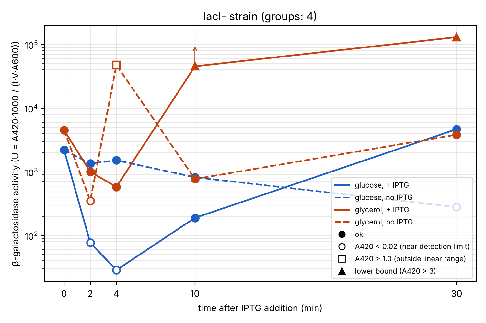

# lac operon induction kinetics

Data from the regulatory biology laboratory course at OVGU Magdeburg (June 2025). We measured beta-galactosidase activity in a lacI-negative *E. coli* strain grown on glucose or glycerol, with and without IPTG, at 0, 2, 4, 10 and 30 minutes. Activity comes from the ONPG assay (A420), normalised to cell density (A600).

## What the script does

1. Reads the results table (CSV or Excel) and cleans it: German and English column names, decimal commas, spelling variants such as Glukose/glucose or ohne/none, empty and duplicate rows.
2. Recalculates the activity from the raw readings with U = A420 x 1000 / (t x V x A600) and compares it with the reported table. Wrong condition labels, swapped rows and calculation errors are listed in `data_issues.csv`.
3. Flags readings the course script does not accept: A420 above 1.0 (outside the linear range), "> 3" (photometer overflow, so only a lower bound) and A420 below 0.02 (close to the detection limit).
4. Calculates the glycerol/glucose and IPTG/no-IPTG ratios with a reliability label for each, pools replicate groups and plots the kinetics.

## Result for our group

- Before induction, activity on glycerol was 2.05 times higher than on glucose. Both readings were in the valid range, so this ratio is reliable and matches catabolite repression through cAMP-CRP.
- 7 of the 18 raw readings were flagged: four close to the detection limit, one above the linear range and two photometer overflows. The overflow points are drawn as triangles with an arrow because the true activity is higher than shown.

## Files

| File | Content |
|---|---|
| `data/lab_notebook/group4_raw_readings.csv` | A600 (1:5 dilution) and A420 for all 18 samples |
| `data/shared/group4_reported_activities.csv` | Activities as reported in our lab report, German number format |
| `results/python/clean_data.csv` | Cleaned data with quality flag per reading |
| `results/python/key_ratios.csv` | Glycerol/glucose and IPTG/no-IPTG ratios with reliability |
| `results/python/pooled_kinetics.csv` | Mean, SD and n per condition (reliable points only) |
| `results/python/data_issues.csv` | Differences between raw data and reported table |

In the course, every group entered its results into one shared table. This public version contains only my own group's data.
